# MVP 1 evidence — Qampus v1.0.0 (Quorum One)

Evidence of the Cut 1 release, captured from the running system on the week-5 release
session. Team: Quorum One — Juan Diego Andrade Cardozo (`DarksChoise`).

| Artifact | Link |
|---|---|
| Release tag | https://github.com/code-corhuila/quorum-one/releases/tag/v1.0.0 |
| Product repository (develop / qa / main, PRs #2–#12) | https://github.com/code-corhuila/quorum-one |
| CI (ruff + pytest + frontend build) | https://github.com/code-corhuila/quorum-one/actions |
| Project board (all Cut 1 items Done) | https://github.com/orgs/code-corhuila/projects/26 |
| SDD documentation | https://github.com/code-corhuila/qone-docs |
| UX/UI documentation with these screens (PR) | https://github.com/code-corhuila/qone-docs/pull/4 |

## How the screenshots were produced

Stack booted with `docker compose up -d` at tag `v1.0.0` on a fresh demo database, captured
at 1440×900 with Playwright (`qone-docs/12-ux-ui/assets/capture-screens.py`). Demo accounts
(password `Qampus2026`): Laura Gómez (student, tuition paid), Santiago Rojas (student, unpaid),
Carlos Ramírez (professor), Patricia Mora (admin).

## Screens

### Authentication
| | |
|---|---|
| Login with one-click demo accounts | 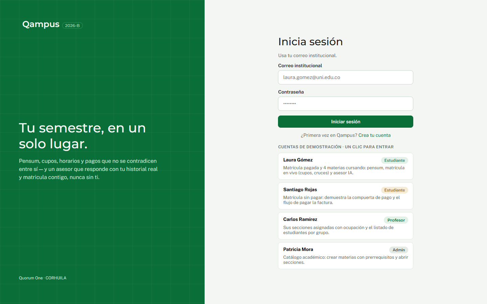 |
| Register | 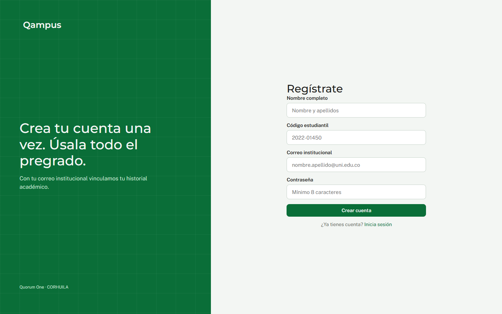 |

### Student
| | |
|---|---|
| Dashboard — progress 26%, 4 confirmed subjects, tuition paid, weekly schedule | 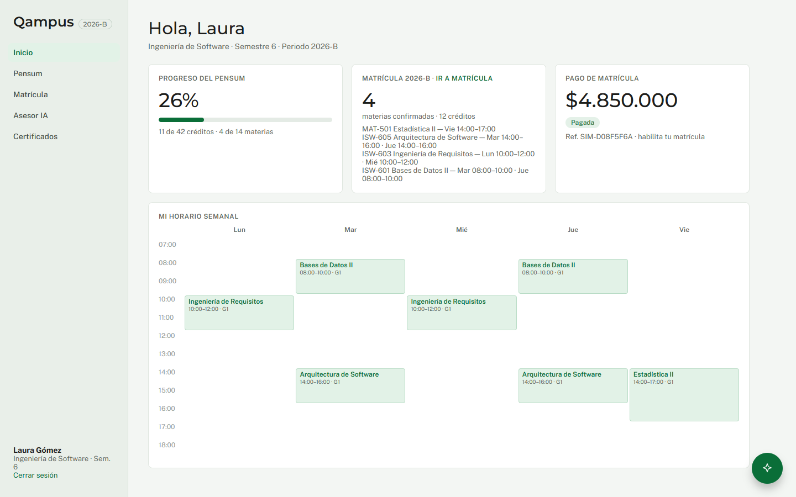 |
| Dashboard with tuition pending ("Pagar (simulado)") | 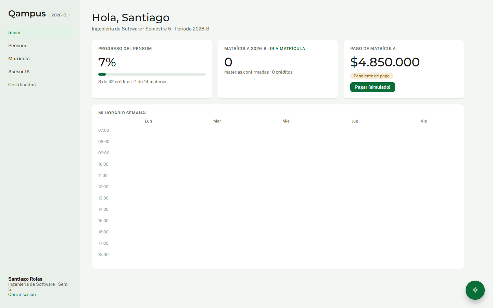 |
| Pensum classified: passed / in progress / available / locked | 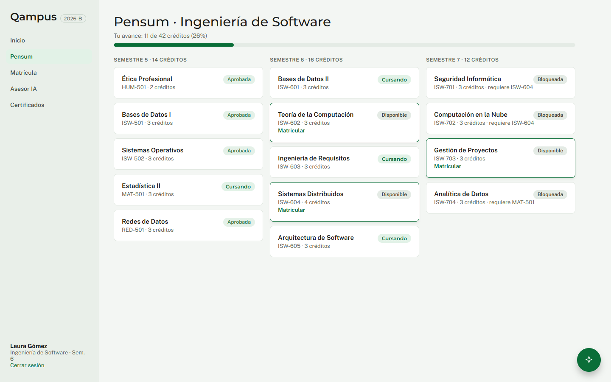 |
| Certificates (5 verifiable PDFs) | 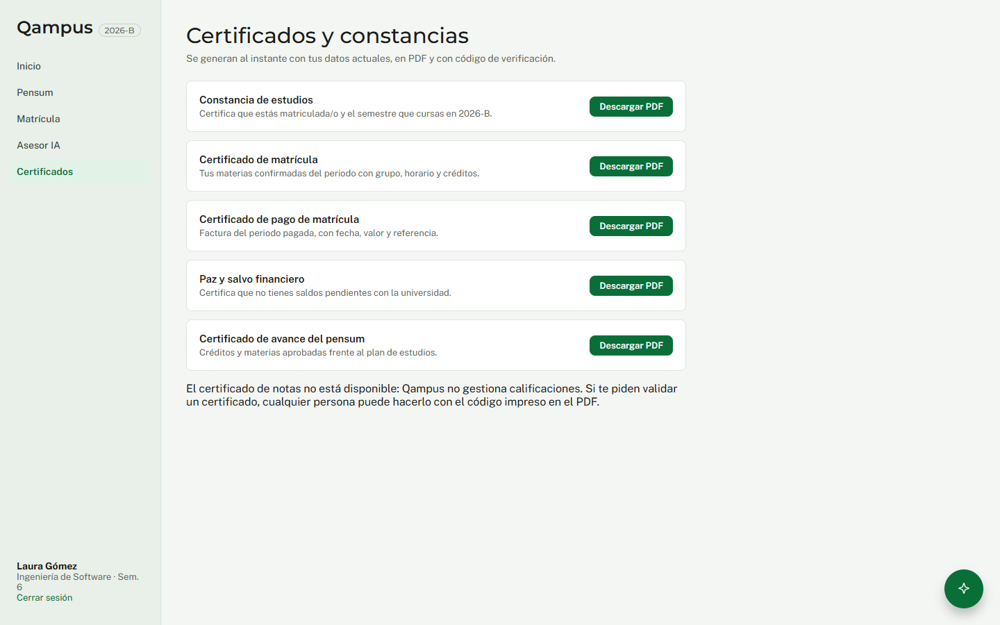 |

### Enrollment — the gates, one screenshot each
| Outcome | Screenshot |
|---|---|
| Groups of ISW-604: group 3 full → chip "Sin cupos", button disabled (`NO_SEATS`) | 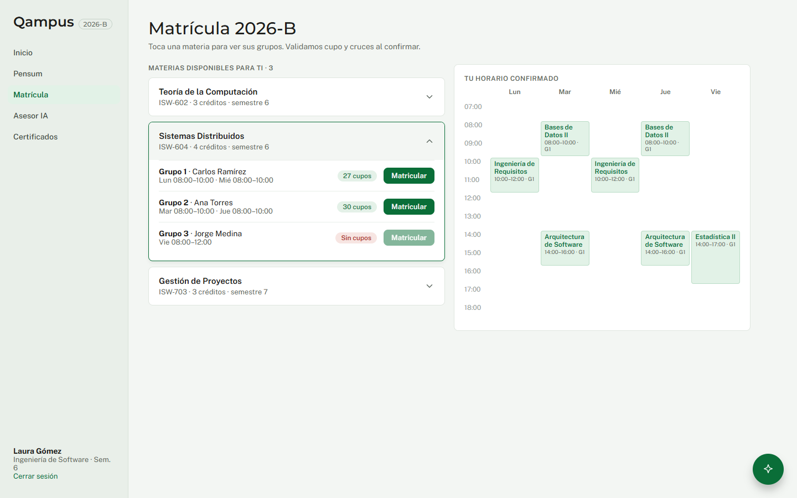 |
| Group 2 crosses the confirmed schedule → `SCHEDULE_CONFLICT`, seat released | 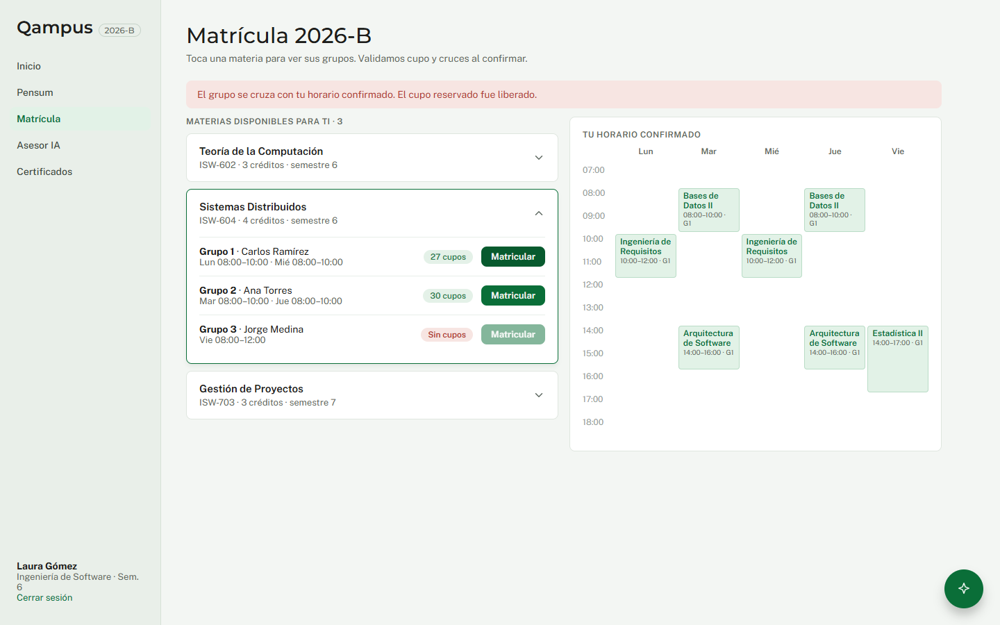 |
| Group 1 contiguous → `CONFIRMED`, seat count 27 → 26 in the same transaction | 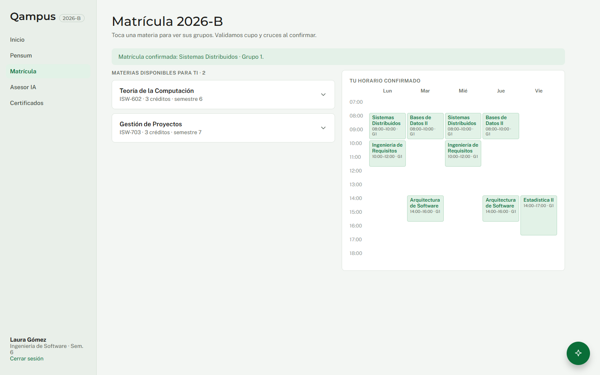 |
| Tuition unpaid (Santiago) → `TUITION_UNPAID` | 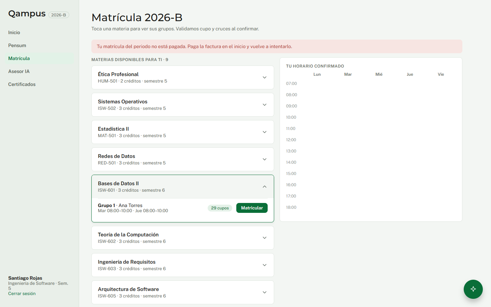 |

### AI advisor — human in the loop
| | |
|---|---|
| Empty conversation with suggested prompts | 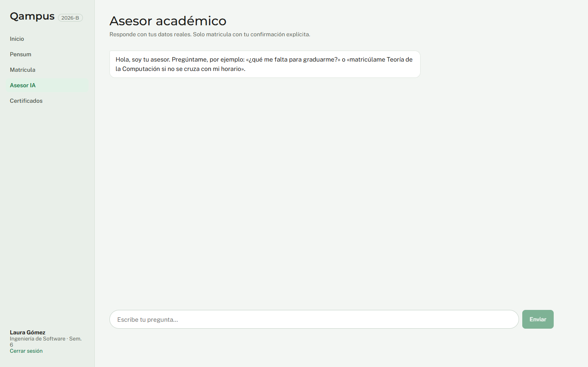 |
| Plan proposed by the agent: requires explicit confirmation (`Confirmar matrícula` / `Descartar`) | 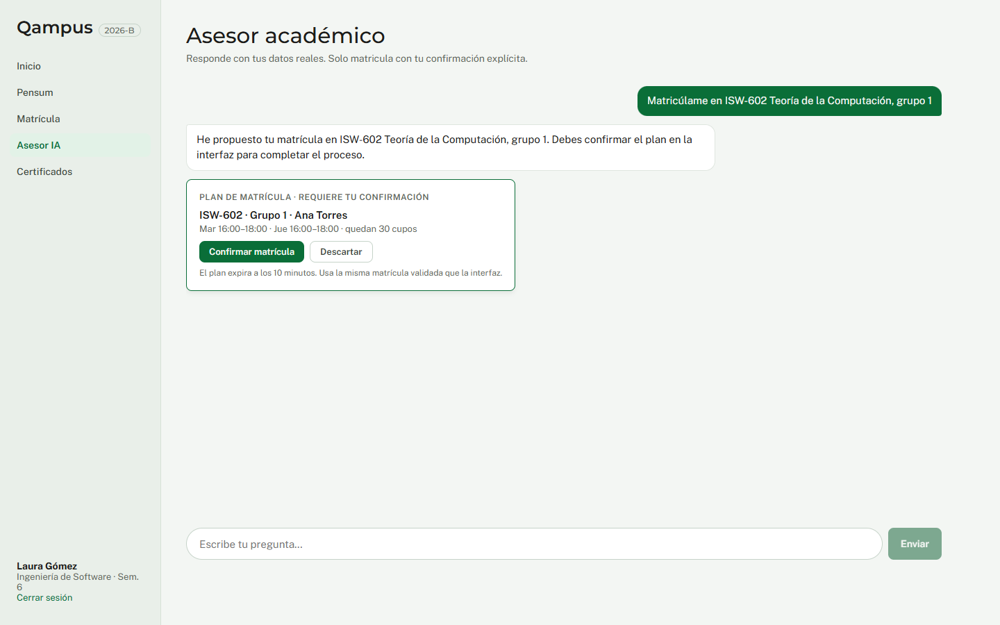 |
| Plan dismissed — nothing was enrolled | 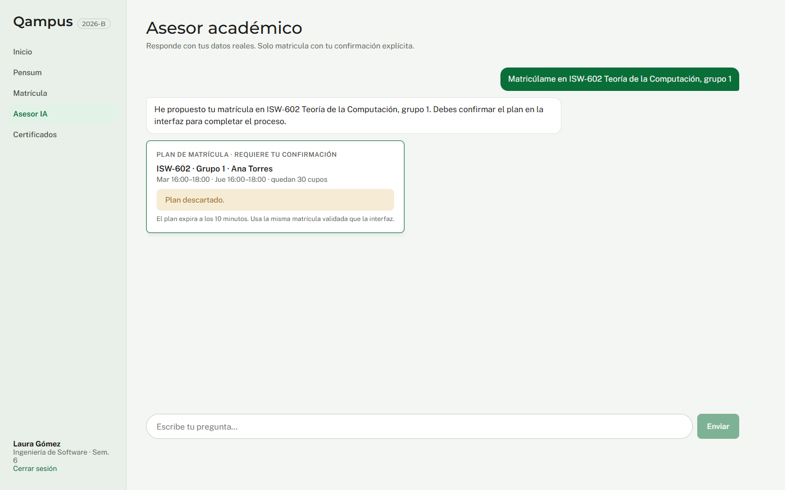 |
| Floating widget over the dashboard | 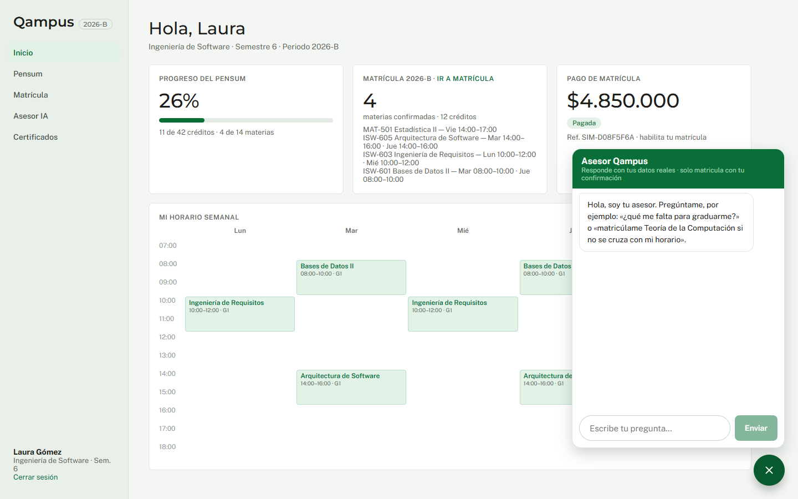 |

### Professor and admin
| | |
|---|---|
| Professor: sections with occupancy and roster | 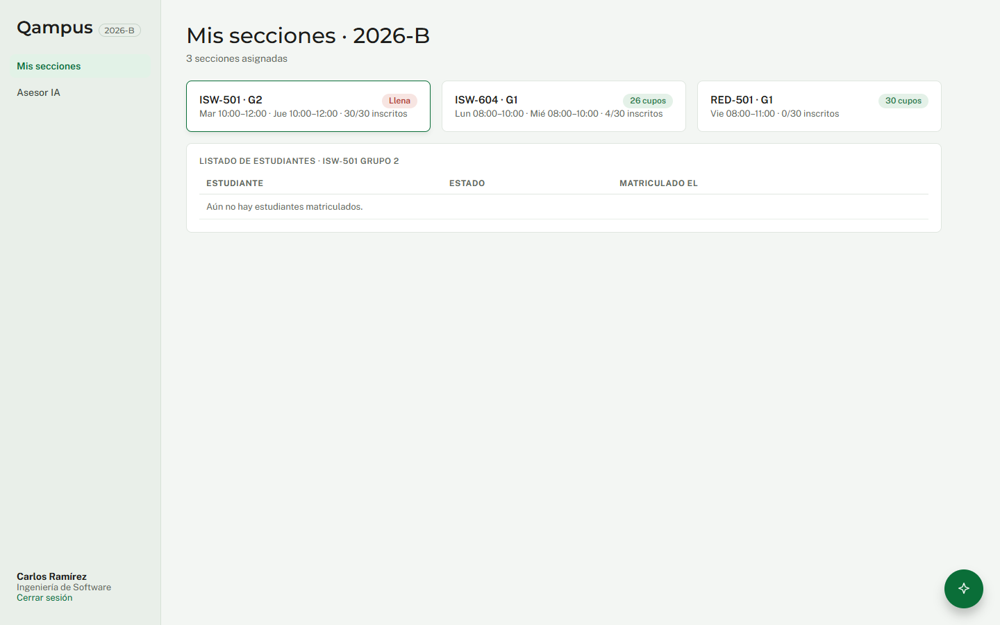 |
| Admin: term sections and "new section" form | 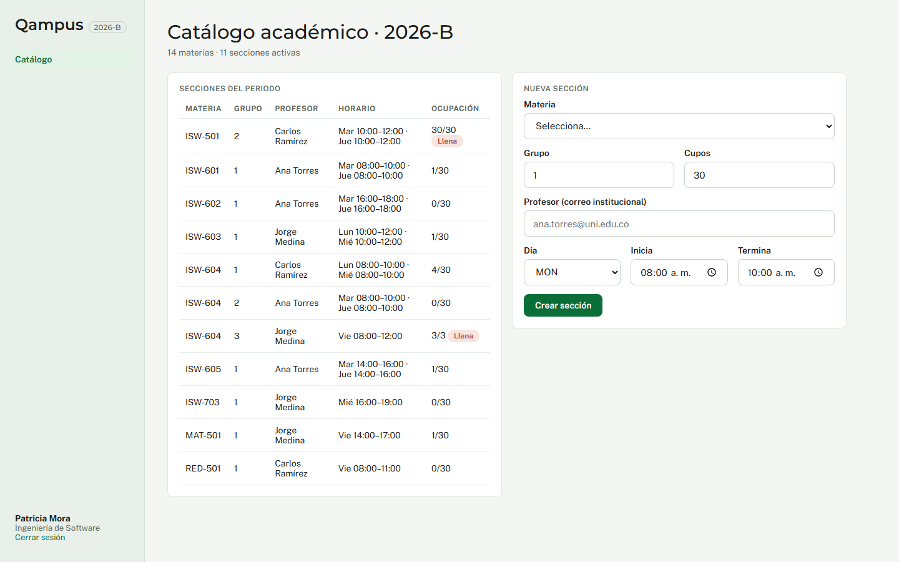 |

## What the evidence shows against the release checklist

- Runs via `docker compose up` against PostgreSQL (all screens are the live system).
- Happy path and the key error paths (`NO_SEATS`, `SCHEDULE_CONFLICT`, `TUITION_UNPAID`) with
  explicit reasons in the UI.
- The agent's write is gated by a human confirmation (plan card) — INV-ADV-003 / INV-ENR-005.
- Architecture, tests and release notes: see the product repository and ADR-002 / ADR-003.
