# MVP 2 evidence — Qampus v2.0.0 (Quorum One)

Evidence of the Cut 2 release: the twenty `qone-*` repositories of the course norm, released on
`main` with tag `v2.0.0`. Team: Quorum One — Juan Diego Andrade Cardozo (`DarksChoise`).

| Artifact | Link |
|---|---|
| Releases (one per repository), e.g. the composition | https://github.com/code-corhuila/qone-infra/releases/tag/v2.0.0 |
| Promotion to `qa` by `cherry-pick -x` (one PR per repository), e.g. | https://github.com/code-corhuila/qone-catalog-api/pull/11 |
| Release PR to `main` with the five elements (stories, trail, scope, deployment, rollback), e.g. | https://github.com/code-corhuila/qone-catalog-api/pull/12 |
| Cut 2 user stories (closed, Done (DoD), Environment Main) | https://github.com/code-corhuila/qone-docs/issues?q=is%3Aissue+created%3A2026-10-07 |
| Project board | https://github.com/orgs/code-corhuila/projects/26 |
| SDD documentation (v2 stack pending approval in #49) | https://github.com/code-corhuila/qone-docs/pull/49 |

## The twenty repositories

| Kind | Repositories |
|---|---|
| Databases (PostgreSQL 16, Flyway, V and U scripts, seeds as upserts) | `qone-identity-db`, `qone-catalog-db`, `qone-enrollment-db`, `qone-billing-db`, `qone-advisor-db` |
| Services (Python 3.12, FastAPI, hexagonal, test-first) | `qone-identity-api`, `qone-catalog-api`, `qone-enrollment-api`, `qone-billing-api`, `qone-advisor-api` |
| Web (React 19, Module Federation, MSW, Vitest) | `qone-front` (shell) and the portals `qone-identity-portal`, `qone-catalog-portal`, `qone-enrollment-portal`, `qone-billing-portal`, `qone-advisor-portal` |
| Cross-cutting | `qone-workflow` (orchestrated `enroll-student` saga, Redis), `qone-worker` (outbox relay to RabbitMQ, plan expiry, LLM cache prune), `qone-api-gateway` (NGINX), `qone-infra` (composition, environments, scripts, observability) |

## How it was validated

On 2026-10-13 the whole platform was rebuilt from zero with every repository at `qa`
(`qone-infra/scripts/down.sh --volumes`, `up.sh`: five schemas migrated and seeded, every
container healthy), `scripts/smoke.sh` passed, and the acceptance battery
[`acceptance.py`](acceptance.py) ran through the gateway: **64 of 64** checks
([`acceptance-qa.log`](acceptance-qa.log)). It covers sign-in and registration, the catalog and the
pensum, the invoice and its payment, the four gates of the saga plus DUPLICATE, the events into the
projections, the certificate with its PDF and public verification, the advisor with the real model
(grounded audit, refusal of another student's data, a plan expired by the worker, dismissed, and
confirmed into a saga with origin AGENT) and the six web entries. Both scripts read the demo
password from `DEMO_PASSWORD` (the value lives only in `qone-infra/.env`).

## How the screenshots were produced

The platform composed by `qone-infra` at `http://localhost:5173`, signed in through the identity
portal like a person, captured at 1440×900 with Playwright ([`capture_v2.py`](capture_v2.py)).
The v2 portals are functional HTML without visual styling yet; the CORHUILA design of v1.0.0 is
still to be brought to the new portals.

## Screens

### Public
| | |
|---|---|
| Sign in (identity portal at `/login`) | 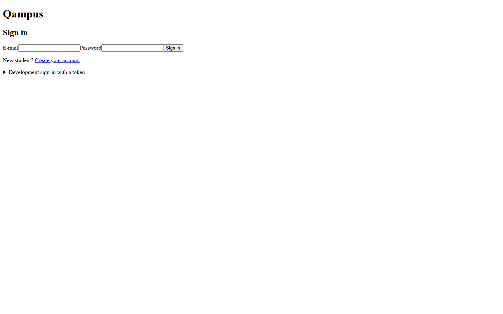 |
| Student registration | 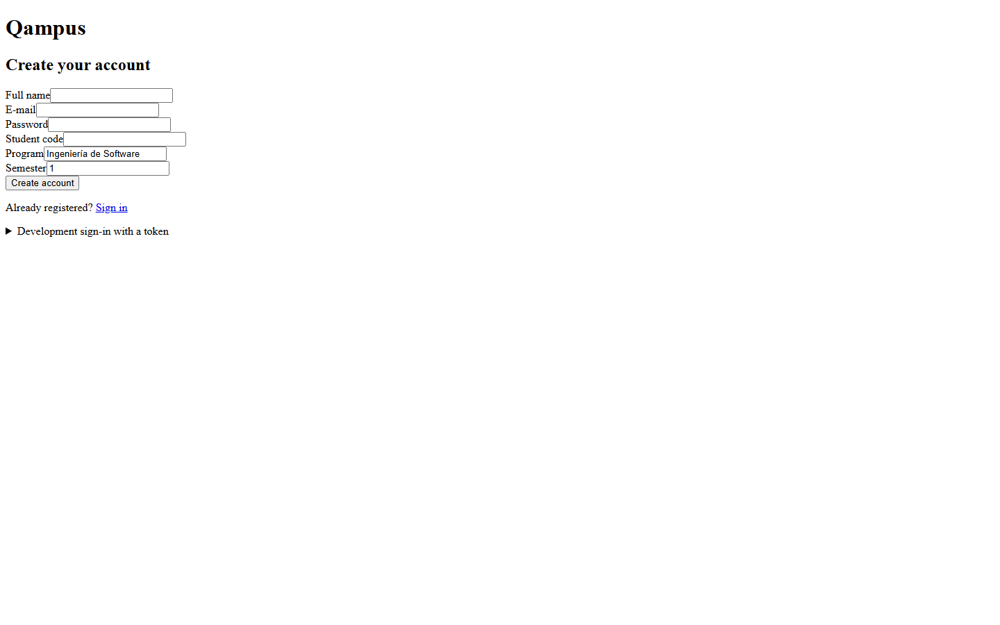 |

### Student
| | |
|---|---|
| Home of the shell | 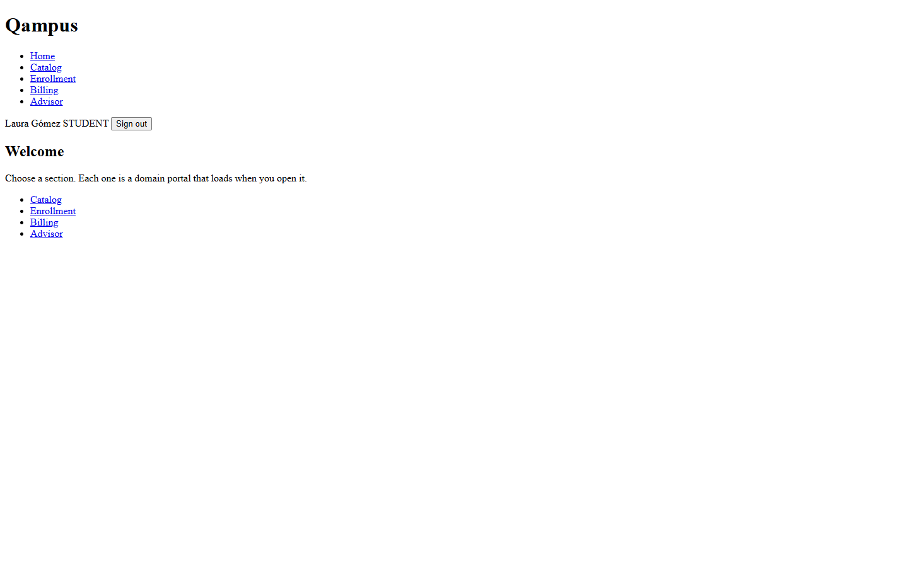 |
| Catalog: subjects | 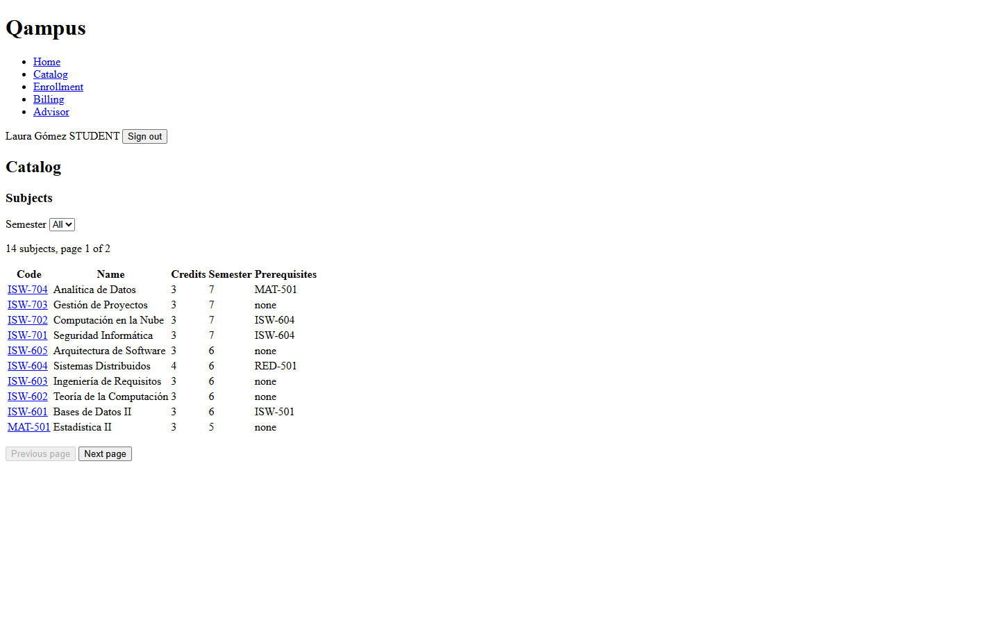 |
| Catalog: a subject with its groups and seats | 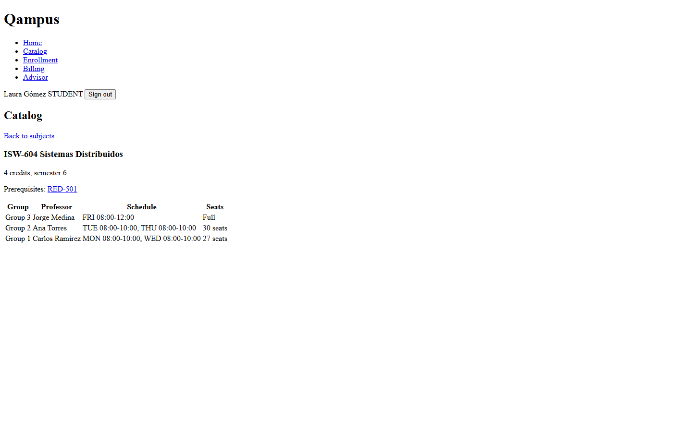 |
| Pensum and degree progress | 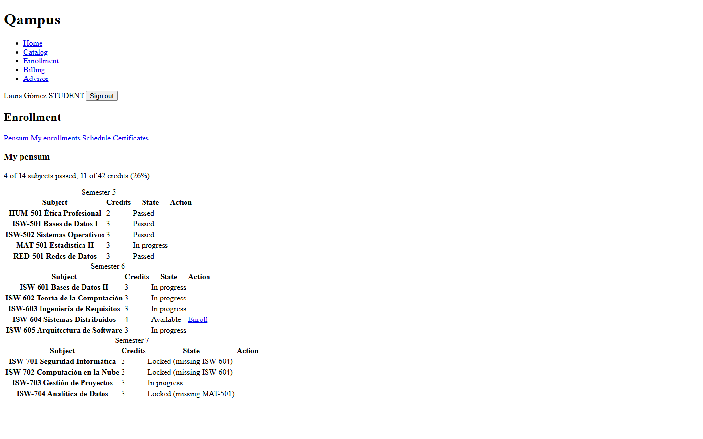 |
| Weekly schedule | 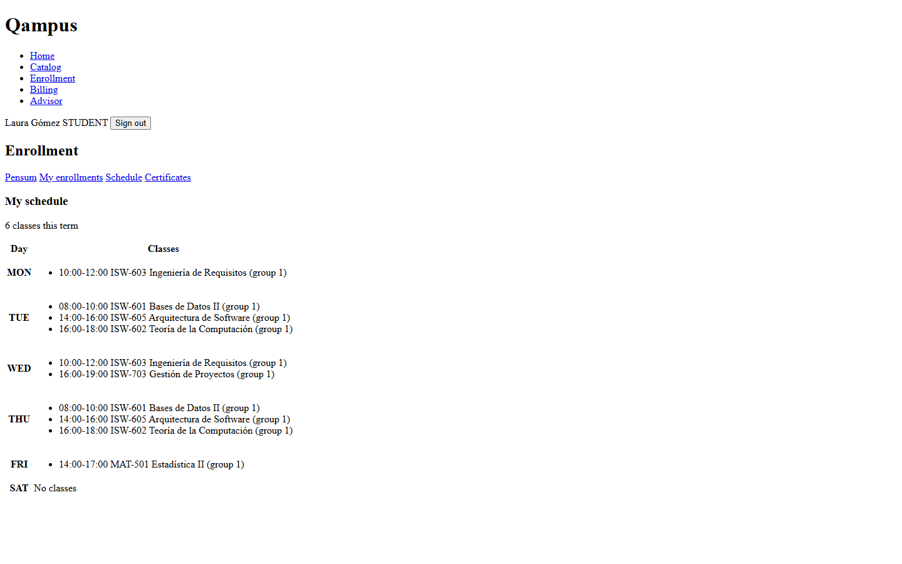 |
| My enrollments | 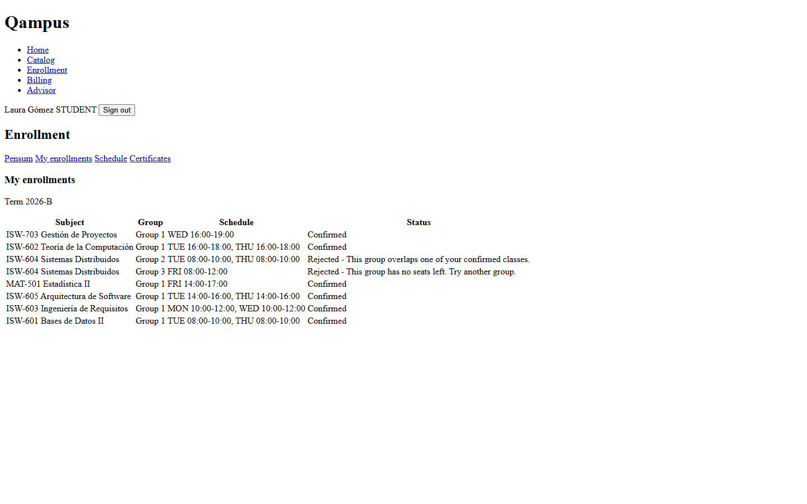 |
| Invoice paid | 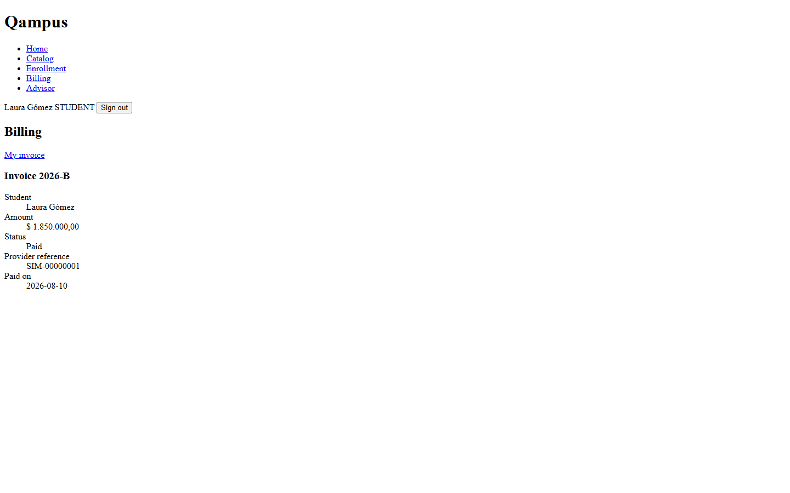 |
| Certificates with the PDF download | 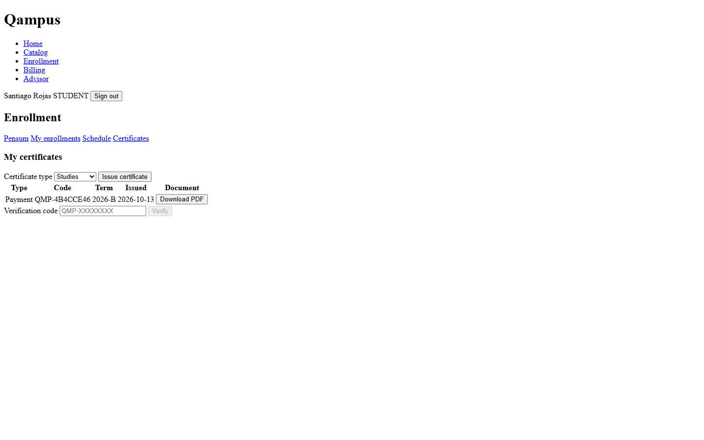 |
| AI advisor: grounded audit and a proposed plan waiting for confirmation | 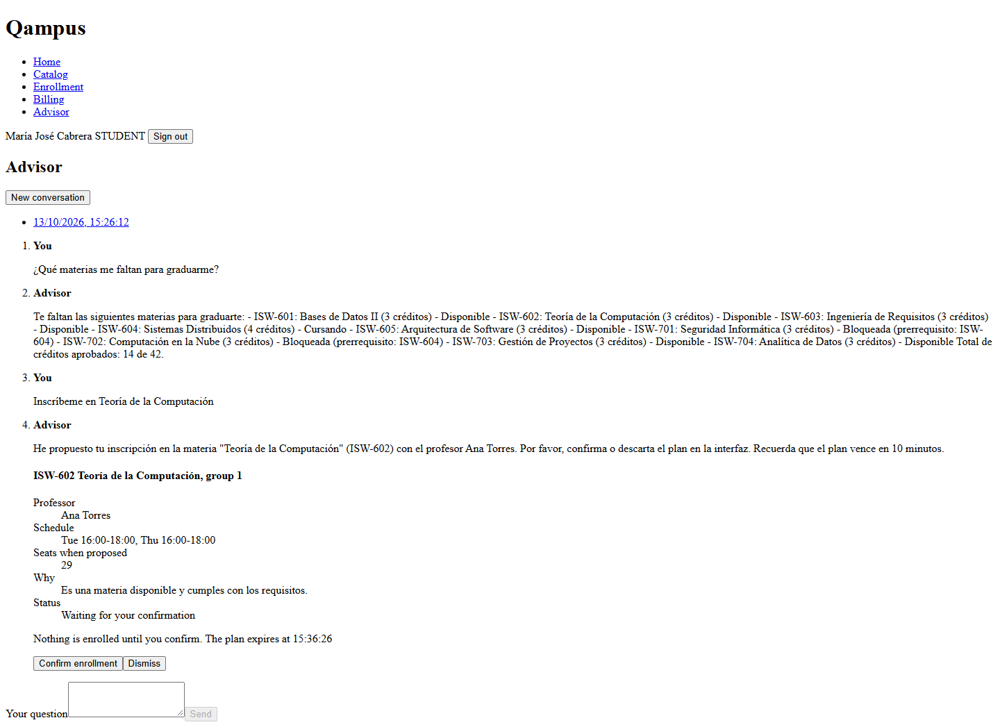 |

### Professor
| | |
|---|---|
| My sections with occupancy and roster | 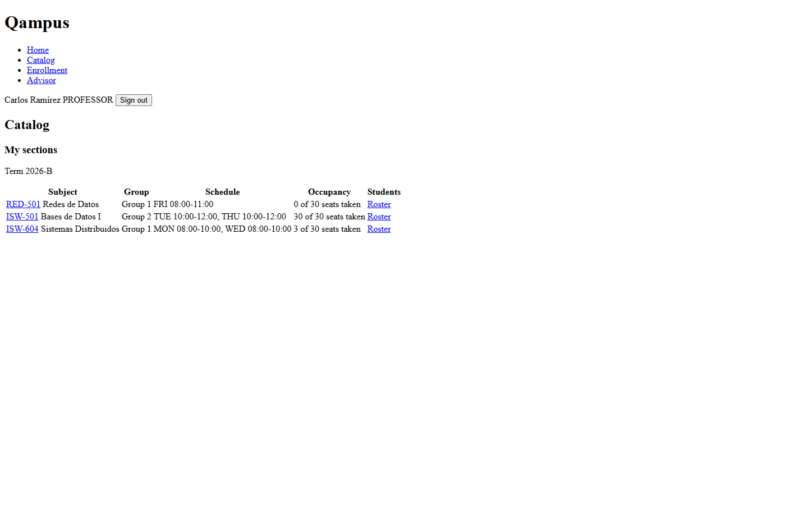 |

### Admin
| | |
|---|---|
| New subject with prerequisites | 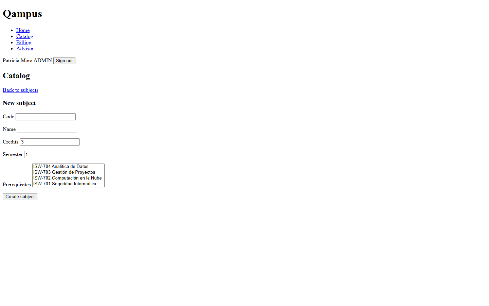 |
| Open a section | 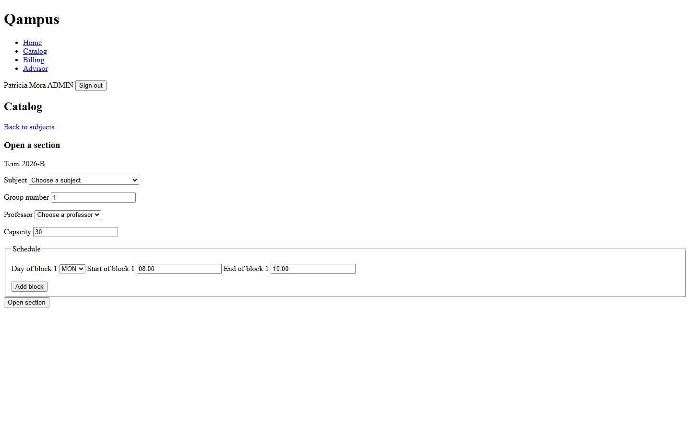 |
| Issue an invoice | 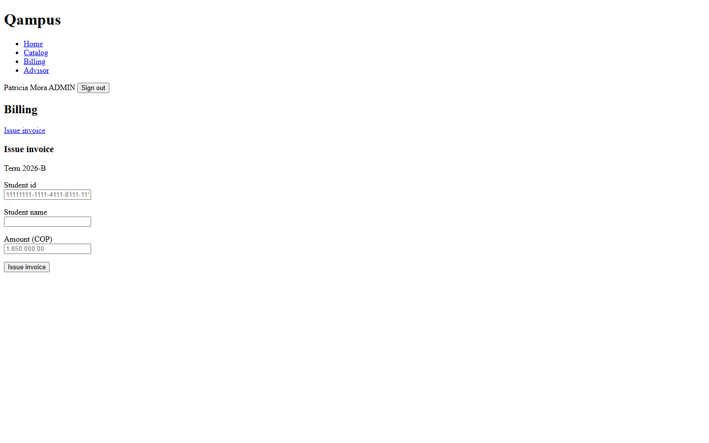 |
