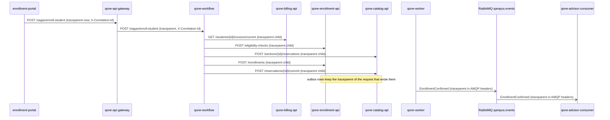

# CP1 - Critical journey and trace map

**Journey: a student enrolls in a section (`enroll-student` saga).** It is the most critical path of
Qampus: it crosses six components and three databases, and a half-done run would leave a seat taken
without an enrollment. Sources in `qone-docs`: `07-api/contracts/openapi/qone-workflow.yaml`,
`qone-billing-api.yaml`, `qone-enrollment-api.yaml`, `qone-catalog-api.yaml`, ADR-008 (orchestrated saga)
and `06-data` (tables `catalog.seat_reservation`, `catalog.section`, `enrollment.enrollment`, outbox).

## Hops

| Step | Caller | Callee | Protocol | Operation | Sync/Async | Data |
|---|---|---|---|---|---|---|
| 1 | browser (`qone-enrollment-portal` in the `qone-front` shell) | `qone-api-gateway` | REST | `POST /api/v1/sagas/enroll-student` | sync | none |
| 2 | `qone-api-gateway` | `qone-workflow` | REST | `POST /api/v1/sagas/enroll-student` | sync | saga state in Redis |
| 3 | `qone-workflow` (check-tuition) | `qone-billing-api` | REST | `GET /api/v1/billing/students/{studentId}/invoices/current` | sync | billing DB (invoice) |
| 4 | `qone-workflow` (check-eligibility) | `qone-enrollment-api` | REST | `POST /api/v1/enrollment/eligibility-checks` | sync | enrollment DB (record, schedule) |
| 5 | `qone-workflow` (reserve-seat) | `qone-catalog-api` | REST | `POST /api/v1/catalog/sections/{id}/reservations` | sync | `catalog.seat_reservation`, outbox `SeatReserved` |
| 6 | `qone-workflow` (confirm-enrollment) | `qone-enrollment-api` | REST | `POST /api/v1/enrollment/enrollments` | sync | `enrollment.enrollment`, outbox `EnrollmentConfirmed` |
| 7 | `qone-workflow` (commit-seat) | `qone-catalog-api` | REST | `POST /api/v1/catalog/sections/{id}/reservations/{reservationId}/commit` | sync | `catalog.section` seats, outbox `SeatCommitted` |
| 8 | `qone-worker` (outbox relay) | RabbitMQ, exchange `qampus.events` | AMQP | publish `EnrollmentConfirmed`, `SeatCommitted` | async | outbox rows |
| 9 | RabbitMQ | `qone-advisor-consumer` | AMQP | consume `EnrollmentConfirmed` | async | advisor projections |

If a step fails after step 5, the saga compensates in reverse: `DELETE /api/v1/catalog/sections/{id}/reservations/{reservationId}`
releases the seat (event `SeatReleased`) and the saga ends `COMPENSATED` with its reason
(`TUITION_UNPAID`, `PREREQ_MISSING`, `SCHEDULE_CONFLICT`, `NO_SEATS` or `DUPLICATE`).

## Trace context today and target

Today every service propagates `X-Correlation-Id` (07-api, common contract): it connects the logs, but
it has no parent/child relation between hops. The target is the W3C `traceparent` header
(`00-<trace_id>-<span_id>-01`) on every HTTP hop, stored in the outbox row with the event and copied by
`qone-worker` into the AMQP message headers, so the consumer continues the same `trace_id`.
`X-Correlation-Id` stays as the business id that the student can quote (the saga id).

## Span tree (one trace_id)

- `POST /api/v1/sagas/enroll-student` - root span, `qone-api-gateway`
  - `saga enroll-student` - `qone-workflow`
    - `check-tuition` - `GET .../invoices/current` - `qone-billing-api`
    - `check-eligibility` - `POST /eligibility-checks` - `qone-enrollment-api`
    - `reserve-seat` - `POST /sections/{id}/reservations` - `qone-catalog-api`
      - `INSERT catalog.seat_reservation` + outbox `SeatReserved`
    - `confirm-enrollment` - `POST /enrollments` - `qone-enrollment-api`
      - `INSERT enrollment.enrollment` + outbox `EnrollmentConfirmed`
    - `commit-seat` - `POST .../commit` - `qone-catalog-api`
  - `outbox relay EnrollmentConfirmed` - `qone-worker` (crosses the async boundary, same trace_id)
    - `consume EnrollmentConfirmed` - `qone-advisor-consumer`, updates the advisor projection
