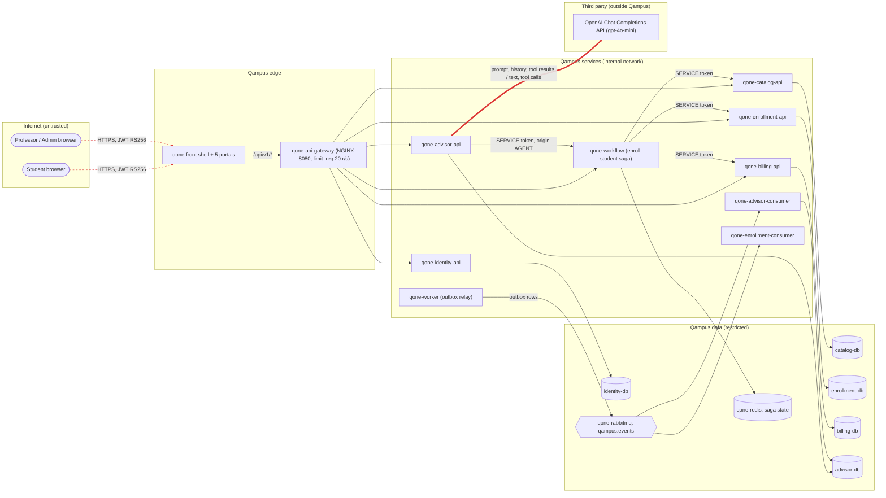

# CP1 - Attack surface and trust boundaries of Qampus

Sources: `qone-docs/03-product/vision.md`, `05-architecture/overview.md`, `05-architecture/deployment.md`,
`07-api/endpoint-catalog.md`, `09-microservices/service-catalog.md` and the compose files of the
`qone-*` repositories (release `v2.1.0`).

## Data flow diagram

Every node exists in `qone-docs`. Dashed red lines are trust boundaries (TB); **TB6 is mine**.

| TB | Boundary | What crosses |
|---|---|---|
| TB1 | Internet -> `qone-api-gateway` | every `/api/v1/*` call with a Bearer JWT |
| TB2 | `qone-api-gateway` -> each `qone-*-api` | the same call; each service validates the RS256 token by itself |
| TB3 | `qone-workflow` / `qone-advisor-api` -> participants | service-to-service calls with a SERVICE token |
| TB4 | each service -> its `*-db` / `qone-redis` | SQL and saga state |
| TB5 | `qone-worker` -> `qone-rabbitmq` -> consumers | domain events (`EnrollmentConfirmed`, `SectionUpdated`, `TuitionPaid`...) |
| **TB6** | **`qone-advisor-api` -> OpenAI** | **student question, history, tool results out; reply text and tool calls in** |

TB6 is the only boundary where Qampus data leaves infrastructure we run, and the only one where
the answer that comes back is written by a model, not by our code.

## Asset inventory (advisor domain)

| # | Asset | Where it lives | Classification |
|---|---|---|---|
| A1 | `OPENAI_API_KEY` | `qone-infra/.env` -> environment of `qone-advisor-api` | restricted |
| A2 | Conversation content (questions and replies, up to 2,000 / 8,000 chars) | `advisor.message`, `advisor.conversation` | confidential |
| A3 | Student projections sent as tool results (degree audit, schedule, tuition status) | `advisor.student_view`, `advisor.catalog_section_view` | confidential |
| A4 | Enrollment plans and their `confirmation_id` | `advisor.plan` | confidential |
| A5 | Cached provider answers | `advisor.llm_cache` (key = SHA-256 of model + prompt, 7 days) | confidential |
| A6 | Advisor SERVICE token (starts the saga with `origin: AGENT`) | `SERVICE_TOKEN` env of `qone-advisor-api` | restricted |
| A7 | System prompt and tool definitions | code of `OpenAIAgent` / `AdvisorTools` | internal |
| A8 | Pensum and section list (`list_sections`) | `advisor.catalog_subject_view`, `advisor.catalog_section_view` | public |

## Entry points of TB6

| # | Entry point | Direction | Who calls it | Authentication today |
|---|---|---|---|---|
| E1 | `POST https://api.openai.com/v1/chat/completions` (LangChain `ChatOpenAI`, up to 6 rounds per reply) | out | `OpenAIAgent.reply`, only from AD-05 | `Authorization: Bearer OPENAI_API_KEY`, TLS of the provider |
| E2 | The provider's response: assistant text and `tool_calls` (name + JSON args) | in | OpenAI, as the answer to E1 | none: trusted because it came over TLS from the configured base URL |
| E3 | AD-05 `POST /api/v1/advisor/conversations/{id}/messages` (the trigger of E1) | in | student, professor or admin through `qone-api-gateway` | JWT RS256 checked by `TokenVerifier`; owner only (404 otherwise) |
| E4 | `advisor.llm_cache` lookup / update around E1 | both | `PostgresLlmCache` | database user of `qone-advisor-api` |
| E5 | Projection events that become tool results (`SectionCreated`, `SectionUpdated`, `SubjectCreated`) | in | `qone-advisor-consumer` from `qampus.events` | RabbitMQ user; the text of a section reaches the prompt |
| E6 | AD-01 `GET /api/v1/advisor/health` reports `llm` and `model` | out | anyone | public |
